# PC FORGE // 3D 智能电脑主机装配与数字孪生实验室

<p align="center">
  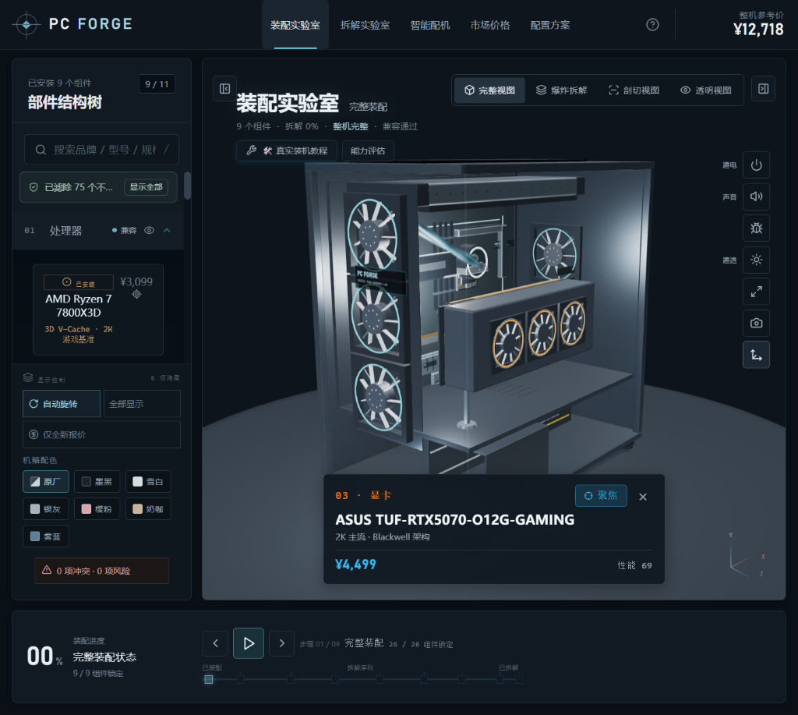
</p>

<p align="center">
  
  
  
  
  
  
</p>

---

## 📖 项目简介 (Overview)

**PC FORGE** 是一个以 **高精度 3D 数字孪生** 为核心的下一代智能电脑装机与硬件仿真实验平台。在同一个沉浸式深色 HUD 界面中，打通 **真实部件选型、全真尺寸装配、空间防穿模仿真、物理水流动力学、通电 ARGB 氛围模拟、全机主题定制、毫秒级硬件兼容检测、智能多场景预算配机与方案一键导出**。

中文为第一界面语言，兼具专业装机工坊的严谨工业感与未来科技质感。

---

## ✨ 核心特性 (Key Features)

### 1. 🖥️ 全真程序化 3D 硬件数字孪生系统
- **严格遵循真实工业尺寸与规范**：机箱、主板、CPU、AIO一体式水冷、双塔风冷、内存、显卡、全模组电源、M.2 NVMe SSD、机械硬盘、机箱风扇、PCIe 扩展卡全部采用程序化参数高精度建模。
- **杜绝穿模与千篇一律**：
  - **显卡专属定制**：旗舰 RTX 5090 / 5080 / 4090 等系列均具备专属散热鳍片、导热铜管、背板印花与实时显存规格铭牌。
  - **电源个性化外观**：ROG THOR 实时功耗 OLED 屏、美商海盗船 Corsair 标志性明黄赛车侧腰线、全模组接口阵列。
  - **AIO 一体式水冷系统**：采用三维三次贝塞尔曲线物理贴合水管，带编织网材质、微凸冷排端盖水箱、金属螺纹快拧接头与流动发光水液粒子效果。
  - **后窗 PCIe 冲压防尘挡板**：标准 7 槽横向微公差冲压嵌合，带百叶窗条形散热镂空与固定螺钉，绝不悬空穿模。

<p align="center">
  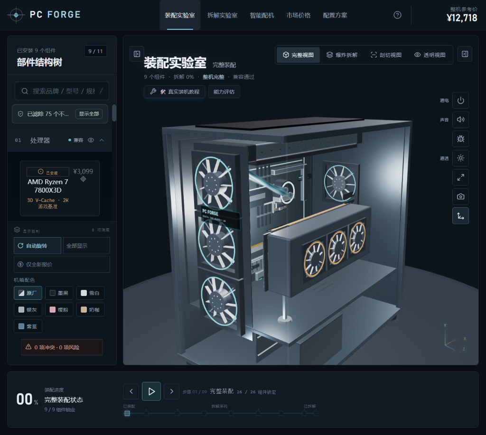
  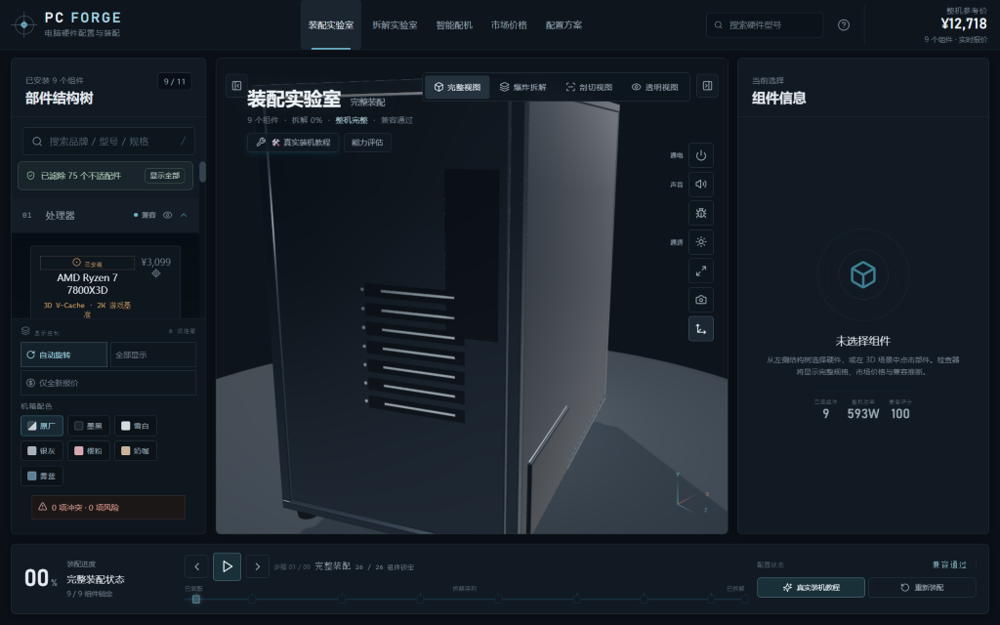
</p>

### 2. ⚡ 动态物理仿真与装机流程
- **通电点亮 (Power ON)**：机箱风扇真实转动、ARGB 幻彩动态渐变流光、水冷液发光循环流动、主板与显卡呼吸灯效。
- **自由视口模式**：完整装配视图、自由爆炸图 (Exploded View)、轴向剖切图 (Section View)、X 光透明线框 (X-Ray View)。
- **交互级部件定位**：支持单件聚焦、隔离查看、一键隐藏、独立分离装配与一键归位。
- **10 步真机实装教程时间轴**：机箱准备 → CPU 安装 → 内存插槽 → M.2 固态 → 主板入箱 → 散热器固定 → 显卡锁紧 → 电源就位 → 机箱风扇 → 理线点亮，支持按步骤演示与自动播放。

<p align="center">
  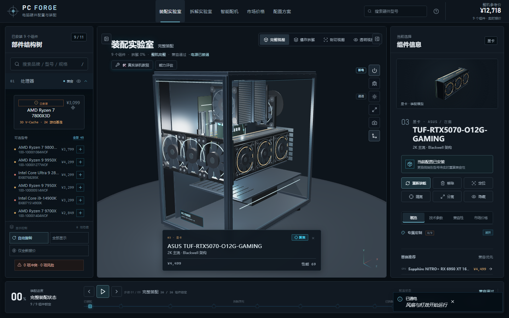
  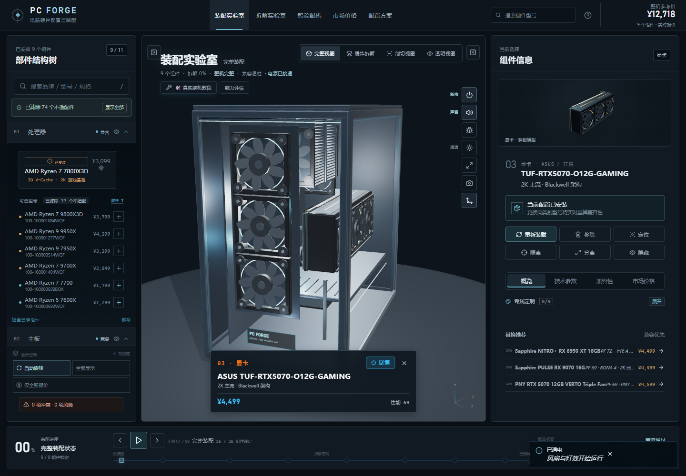
</p>

### 3. 🎨 深度个性化全机定制 (Customization Studio)
- **多风格机箱与材质**：海景房纯白全透、深空黑网孔散热、原木典雅、粉色次元等多种侧透及外壳质感。
- **部件表面工艺与图案定制**：支持双色阳极氧化、拉丝金属、碳纤维纹理、激光刻字、作者个性化图片贴花。
- **全机一键主题同步**：可将单个部件的配色与纹理一键同步至全机配件，或由算法自动生成和谐全局主题。

<p align="center">
  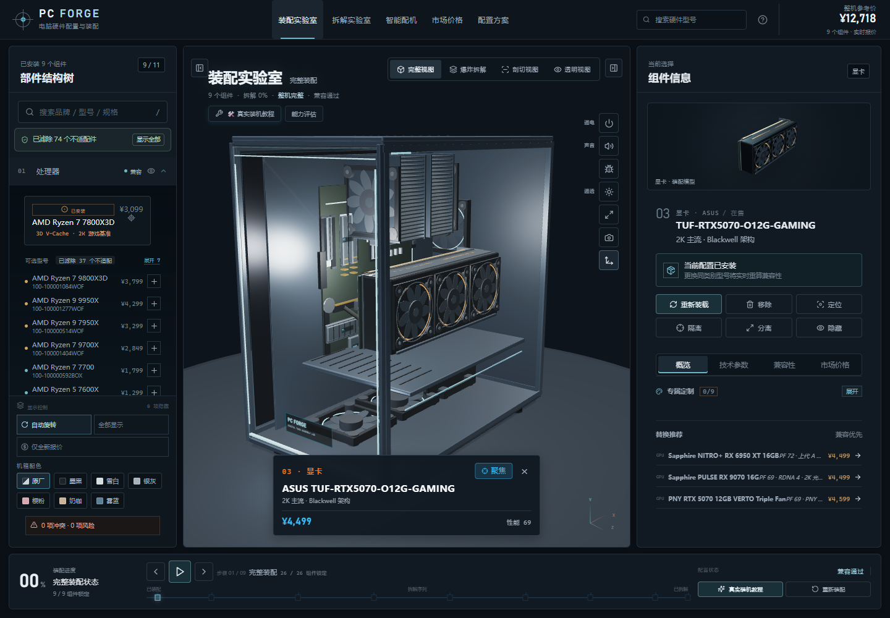
  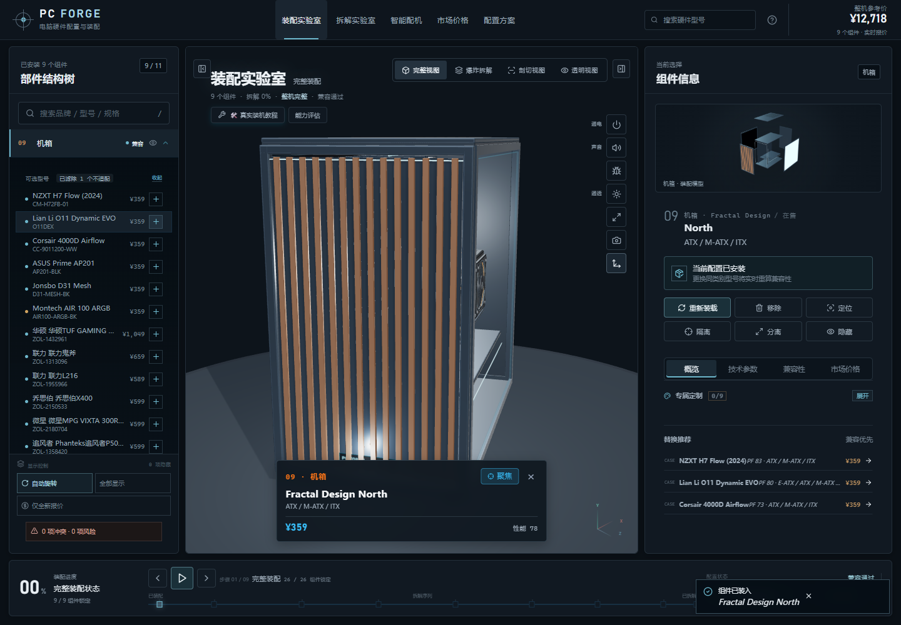
  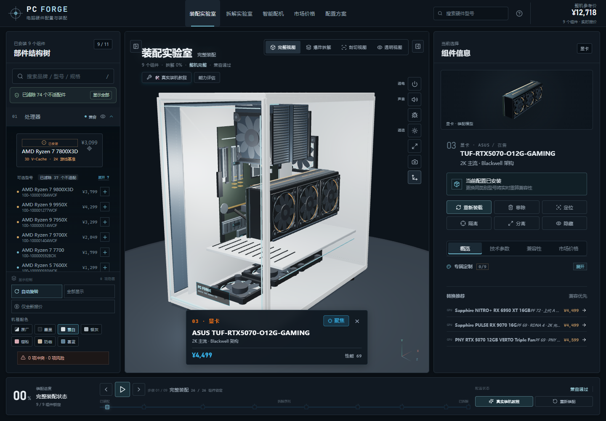
</p>

<p align="center">
  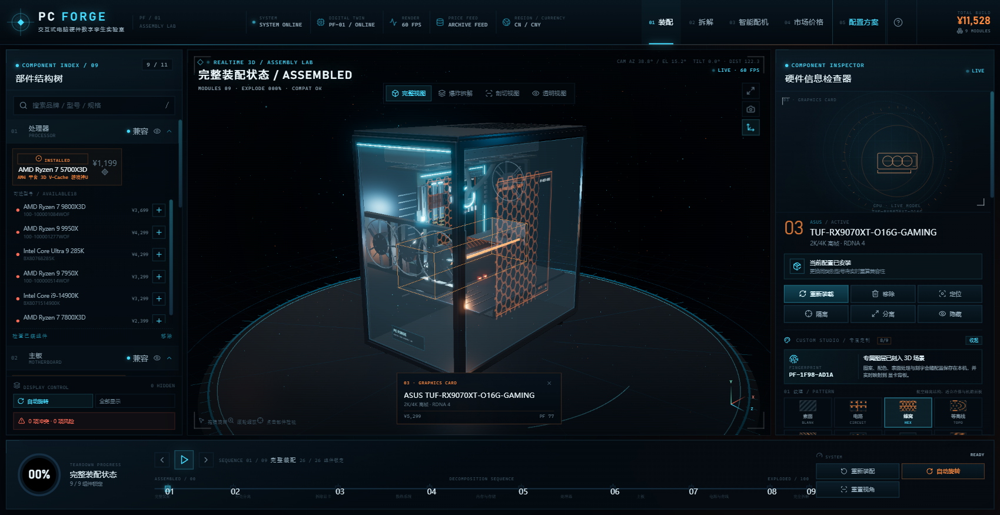
</p>

### 4. 🧠 毫秒级多维度兼容性诊断引擎
- **全方位空间与电气核验**：
  - CPU 插槽与主板芯片组引脚兼容（LGA1700 / LGA1851 / AM5 等）。
  - 散热器限高、水冷排尺寸（240/280/360mm）与机箱冷排位校验。
  - 显卡长度（mm）、插槽厚度（2/3/3.5 Slot）与机箱内部纵深冲突检测。
  - 内存限高与大型风冷双塔避让。
  - 整机额定功耗估算、瞬时峰值安全余量与电源 12V-2x6 接口兼容。
- **智能诊断与替换建议**：实时标出硬性冲突（红）、潜在风险（黄）与安全通过（绿），提供一键替换配件方案。

<p align="center">
  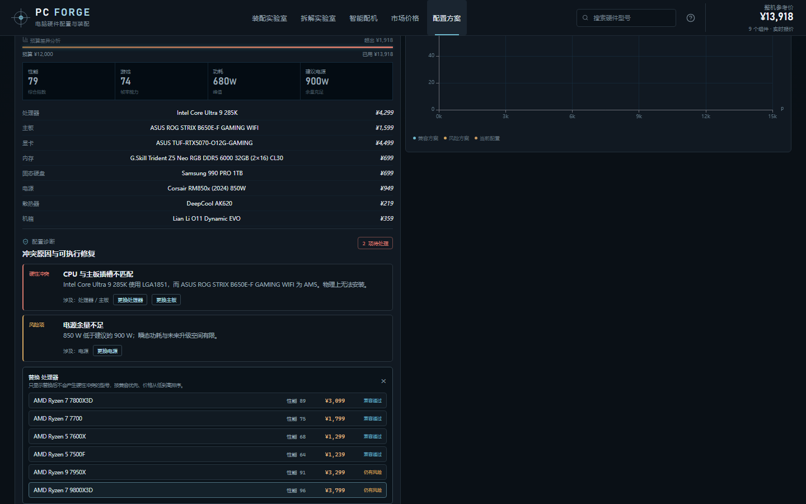
</p>

### 5. 🎯 场景化智能预算配机与价格系统
- **六大多维工作负载场景**：电竞游戏（分辨率与刷新率）、专业剪辑（视频流规格）、3D 渲染与建模、AI 本地大模型部署（显存门槛）、编程开发与日常办公。
- **智能生成最优方案**：自动输出高性价比方案、平衡方案与极致旗舰方案，列出推荐理由、潜在瓶颈与升级潜力。
- **配置单专业导出**：一键导出高清带图配置单、标准 CSV 与中文专业 A4 PDF 装机清单。

<p align="center">
  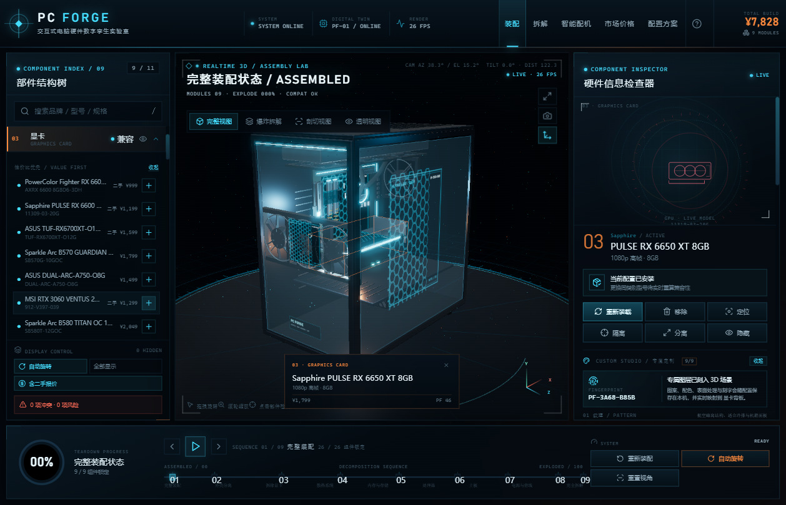
</p>

---

## 🏗️ 架构与技术栈 (Architecture & Tech Stack)

```text
pc-forge/
├── src/                          # 前端核心源码 (Vue 3 + Three.js)
│   ├── components/               # 3D 视口、装配时间轴、检查器、HUD 面板
│   │   ├── Viewport.vue          # Three.js 核心视口与相机控制
│   │   ├── ComponentTree.vue     # 部件层级目录与快速选取树
│   │   ├── Inspector.vue         # 硬件详情检查器、3D 实时快照与参数展示
│   │   ├── Timeline.vue          # 10 步装机向导与动画进度时间轴
│   │   ├── Customizer.vue        # 部件表面处理、贴图、颜色与刻字定制
│   │   └── Workbench.vue         # 核心装配工作台主容器
│   ├── pages/                    # 路由子页面
│   │   ├── SmartBuilder.vue      # 多场景智能装机推荐
│   │   ├── MarketPage.vue        # 硬件市场价格走势与目录
│   │   └── BuildsPage.vue        # 配置单管理、兼容诊断与方案对比
│   ├── stores/                   # Pinia 状态管理 (装配、配置单、定制持久化)
│   ├── services/                 # 核心算法与服务
│   │   ├── compatibility.ts      # 纯前端毫秒级兼容性判定引擎
│   │   ├── recommender.ts        # 场景化智能硬件求解与评分系统
│   │   ├── export.ts             # PDF / CSV / JSON 导出引擎
│   │   └── priceAdapter.ts       # 市场价格适配与报价聚合
│   ├── three/                    # Three.js 程序化 3D 模型与场景生成器
│   │   ├── pcScene.ts            # 主装配场景、物理部件定位、线缆管路与动画
│   │   ├── materials.ts          # PBR 物理材质库、ARGB 发光着色与透明玻璃
│   │   └── proceduralModels.ts   # 芯片、电容、热管、螺钉等微几何构造器
│   └── data/                     # 硬件产品库种子与规格定义 (catalog.json)
├── backend/                      # Python FastAPI 后端服务
│   ├── main.py                   # 价格适配服务、产品库 API 与报价网关
│   ├── test_api.py               # 后端接口自动化单元测试
│   └── requirements.txt          # Python 依赖项清单
├── docs/                         # 项目高清演示图、架构图与视觉资产
├── scripts/                      # 目录构建与辅助自动化脚本
├── package.json                  # 前端依赖与脚本配置
└── vite.config.ts                # Vite 6 构建与代理配置
```

---

## 🚀 快速启动指南 (Quick Start)

### 环境要求
- **Node.js**：`>= 20.0.0`
- **npm**：`>= 10.0.0`
- **Python**（可选，用于后端价格与目录服务）：`>= 3.10`

### 1. 克隆代码仓库
```bash
git clone https://github.com/ymqzhy999/computer.git
cd computer
```

### 2. 启动前端 3D 实验室
```powershell
# 安装依赖
npm install

# 启动开发服务器 (默认端口 5173 / 5178)
npm run dev
```
打开浏览器访问：**`http://localhost:5173/`** 即可立即体验 3D 装机实验室！

### 3. 启动后端 API 服务（可选）
后端提供硬件目录查询、价格适配接口与健康检查：
```powershell
# 安装 Python 依赖
pip install -r backend/requirements.txt

# 启动 FastAPI 后端 (默认端口 8018)
npm run backend
```
后端启动后将运行在：`http://127.0.0.1:8018/`，Vite 会自动将 `/api` 请求代理至后端。

---

## 🧪 验证与自动化测试 (Testing & Verification)

项目包含全套前端类型检查、核心逻辑测试以及后端 API 自动化测试：

```powershell
# 1. 运行完整 TypeScript 类型检查与 Vite 生产打包
npm run build

# 2. 运行前端兼容算法、功耗测算与智能推荐单元测试
npm test

# 3. 运行后端 FastAPI 接口自动化测试
npm run test:api
```

---

## 🎮 3D 视口快捷操作说明 (Viewport Controls)

| 操作方式 | 功能描述 |
| :--- | :--- |
| **鼠标左键拖拽** | 绕主机中心 360° 自由旋转视角 |
| **鼠标滚轮** | 平滑缩放视距，支持推进观察微小螺钉与接线端子 |
| **鼠标右键拖拽** | 平移摄像机视口 |
| **点击 3D 部件** | 穿透玻璃高亮选中配件并在右侧检查器展示规格 |
| **点击空白区域** | 取消当前部件选中状态 |
| **顶部模式切换** | 快速切换 **完整 / 爆炸拆解 / 剖切剖视 / X光透视** 视图 |
| **通电按钮 (⚡)** | 一键触发通电流程，风扇起转，ARGB 炫彩流光流动 |

---

## 📄 价格与数据说明 (Data Disclaimer)

- 本系统收录的品牌、型号、尺寸规格与接口参数均整理自硬件厂商公开技术白皮书。
- 价格数据标注为“公开市场参考样本”，用于装配预算展示与逻辑推演，不作为实际交易成交承诺。
- 3D 模型采用微公差程序化高精度几何构建，以轻量化、高保真和无缝网页运行为设计宗旨。

---

## 👨‍💻 开发者与许可证

- **Repository**: [https://github.com/ymqzhy999/computer](https://github.com/ymqzhy999/computer)
- 欢迎提交 Issue 与 Pull Request 共同改进 3D 硬件数字孪生系统！
